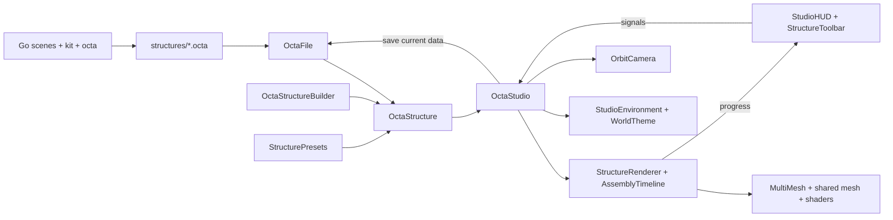

# Architecture and class reference

[Project overview](../README.md) · [Development](development.md) · [Generator](../gen/README.md) · [File format](octa-format.md)

Octa has two independent programs: a Godot desktop viewer and a Go build generator.
Their only runtime interchange is the `.octa` file. The viewer can run with the
checked-in builds without installing Go. Both programs share the same BCC lattice,
validation limits, palette capacity, and binary layout.

## Repository map

| Path | Responsibility |
| --- | --- |
| `project.godot`, `scenes/main.tscn` | Engine settings and the single root scene |
| `scripts/octa_studio.gd` | Application construction, signal wiring, selection, file dialogs |
| `scripts/data/` | Lattice, structure storage, authoring, presets, binary codec |
| `scripts/geometry/` | Cached truncated-octahedron mesh |
| `scripts/rendering/` | Instancing, assembly clock, camera, world environment |
| `scripts/tools/` | Brush tools: stroke input, edit effects, brush cursor |
| `scripts/ui/` | Programmatically built controls, styles, unit diagram, tool palette |
| `shaders/` | Cell motion/materials, procedural sky, ground/water |
| `gen/` | Standalone Go module: `octa` → `kit` → `scenes` → CLI |
| `structures/` | 85 generated builds and the 15-cell `neighbors.octa` fixture |
| `assets/` | SVG app, preset, and gallery icons with Godot import metadata |
| `tests/` | Headless core and real-scene integration scripts |
| `tools/` | GPU capture/benchmark script and macOS background launcher |
| `export_presets.cfg` | Optional Web Preview export configuration |

There are no autoload singletons or dependency injection framework. Shared GDScript
types are registered with `class_name`. The `.tscn` contains one `Node3D` with
`OctaStudio` attached; its children are created in code.

## Application data flow



`OctaStudio._ready()` adds environment, renderer, camera, and HUD, connects signals,
creates Save/Load dialogs, fits the window, and selects Cube. `_present()` is the
common path for a preset or loaded file: update HUD → display data → choose theme →
frame camera → fit environment. Loading failures show an `AcceptDialog` and retain
the current build. Successful saves refresh the gallery.

### Class inventory

| Class / source | Base | Responsibility and main API |
| --- | --- | --- |
| [OctaStudio](../scripts/octa_studio.gd) | `Node3D` | Composition root; `select_preset()`, `toggle_xray()`, `_present()`, file dialogs and keyboard shortcuts |
| [OctaLattice](../scripts/data/octa_lattice.gd) | `RefCounted` | `is_valid()`, `to_world()`, `NEIGHBORS`, coordinate cap |
| [OctaStructure](../scripts/data/octa_structure.gd) | `RefCounted` | Validated packed triples; `from_cells()`, `validation_error()`, `set_colors()`, `color_error()`, getters, `storage_bytes()`, `bounds()` |
| [OctaStructureBuilder](../scripts/data/octa_structure_builder.gd) | `RefCounted` | Mutable occupancy dictionary; `add()`, `remove()`, `contains()`, `build()` sorted by Y/Z/X |
| [OctaEditor](../scripts/data/octa_editor.gd) | `RefCounted` | Pending edits over one structure: `pick()` ray march, `cells_within()` globe/half globe, `free_slots()` attached growth, `add()`/`remove()`, `color_for()`, `build()` |
| [OctaFile](../scripts/data/octa_file.gd) | `RefCounted` | `save_structure()` returns a Godot `Error`; `load_structure()` returns data or `null`; `last_error` explains failures |
| [StructurePresets](../scripts/data/structure_presets.gd) | `RefCounted` | Shape enum, titles/descriptions, `generate()`, `mostly_inside()`, cached volume samples |
| [TruncatedOctahedronMesh](../scripts/geometry/truncated_octahedron_mesh.gd) | `RefCounted` | Unit `vertices()`, `face_normals()`, cached `shared_mesh()` |
| [StructureRenderer](../scripts/rendering/structure_renderer.gd) | `MultiMeshInstance3D` | `display()`, `replay()`, `seek()`, `set_gap()`, `set_xray()`, `drawn_count()`; full/surface instance buffers |
| [AssemblyTimeline](../scripts/rendering/assembly_timeline.gd) | `RefCounted` | `configure()`, `restart()`, `advance()`, `fraction()`, `is_running()`; timing reference via `duration_for()`, `release_time()`, `cell_progress()` |
| [OrbitCamera](../scripts/rendering/orbit_camera.gd) | `Camera3D` | `frame_structure()`, `reset_view()`, orbit/pan/zoom input, auto-orbit, clipping planes |
| [StudioEnvironment](../scripts/rendering/studio_environment.gd) | `Node3D` | Creates sky, ground and two lights; `apply_theme()` and bounds-dependent `fit()` |
| [WorldTheme](../scripts/rendering/world_theme.gd) | `RefCounted` | `name_for()` title lookup, `themes()` dictionaries, studio and shared afternoon defaults |
| [StructureTools](../scripts/tools/structure_tools.gd) | `Node3D` | Tool enum, stroke input, `apply()`, `commit()`, `reset()`, pending-cell and black-hole overlays |
| [BrushGizmo](../scripts/tools/brush_gizmo.gd) | `Node3D` | Globe/dome brush outline, scoop cut-plane ring, billboard black hole |
| [ToolPalette](../scripts/ui/tool_palette.gd) | `PanelContainer` | Tool buttons, brush size, scoop tilt; `show_tool()`, `show_radius()`, `show_tilt()` |
| [StudioHUD](../scripts/ui/studio_hud.gd) | `CanvasLayer` | `show_structure()`, `show_progress()`, `set_xray()`, `notify()`; status, view controls, toasts and FPS |
| [StructureToolbar](../scripts/ui/structure_toolbar.gd) | `PanelContainer` | Preset buttons, `refresh_gallery()`, `select_shape()`, `gallery_paths`, action signals |
| [StudioTheme](../scripts/ui/studio_theme.gd) | `RefCounted` | Color constants and `create()`, `panel()`, `label()`, `button()` factories |
| [UnitGlyph](../scripts/ui/unit_glyph.gd) | `Control` | Draws the unit's 36 edges from the same geometric vertices as the mesh |

The toolbar emits `shape_selected`, `file_selected`, `replay_requested`,
`save_requested`, and `load_requested`. The HUD emits `reset_view_requested`,
`orbit_changed`, `gap_changed`, and `xray_changed`. `OctaStudio` routes them to the
appropriate object. Renderer `assembly_progress(fraction, duration)` updates the
HUD; `assembly_finished` signals natural completion and is used by integration
tests. A direct `seek(1)` updates progress but does not emit `assembly_finished`.

The gallery lists all `.octa` filenames in `res://structures`, sorted by filename.
Its labels are capitalized stems, while the HUD title and world selection come from
the file's embedded title. Shortcuts 5–9 select only the first five entries; this is
not a fixed scene-to-key mapping. Keyboard shortcuts are suppressed while file
dialogs are visible. Unhandled pointer input reaches `OrbitCamera`; it also polls
button release so releasing over UI cannot leave a stuck drag.

## Data model and geometry

The coordinate triple `(x, y, z)` consists of all-even or all-odd integers. Cell
centers are `Vector3(x, y, z) * span / 2`. Six axial offsets of `(±2, 0, 0)` and
eight diagonal offsets of `(±1, ±1, ±1)` meet at the cell's 14 faces. Span-1 volume
is 0.5 cubic unit, so a fully filled lattice has two cells per cubic unit.

`OctaStructure.from_cells()` validates then copies its packed input. Packed getters
return copies; `set_colors()` validates and copies the parallel color array and
palette. Title, span, and palette remain public mutable properties: the object is
not language-enforced immutable. Finish authoring before handing it to the renderer
and leave it unchanged during worker processing. Redisplay after intentional edits
to rebuild transforms, palette uniforms, and surface data. Title length is checked
on file save, not by `from_cells()`.

`storage_bytes()` counts coordinates and indices only: `12N` bytes for uncolored
data or `13N` for colored data. It excludes palette, title, object overhead, builder
dictionaries, and render buffers. `bounds()` encloses world centers and grows by
half a span; empty data returns an empty `AABB`. The builder holds its dictionary
even after `build()`; discard the builder to reclaim it.

Presets accept integer dimensions 2–40, default 10, at span 1. They traverse Y/Z/X
for deterministic bottom-up order. Cube accepts the full lattice envelope; pyramid
keeps `y <= 0` and `max(abs(x), abs(z)) <= -y`; sphere and cylinder require more
than half of sampled cell volume inside their ideal curved boundary. A circumradius
check avoids sampling obvious interior/exterior cells. These are whole-cell
approximations, never clipped boundary meshes.

The unit mesh has 24 geometric vertices and 14 faces. Flat normals require 72
face-local vertices; indexed triangle fans produce 44 clockwise triangles (132
indices). `UV` holds face-local coordinates and `UV2` holds `(side_count, apothem)`.
Shader edge and vertex distances depend on these attributes; replacing UVs with
ordinary texture coordinates would break both materials.

## Rendering, animation, and workers

`display(data, animate=true, recenter=true)` expects non-null, valid data. It builds one full
`MultiMesh`, assigns the shared unit mesh, and uploads this 64-byte instance layout:

| Float offsets | Meaning |
| --- | --- |
| 0–11 | Row-packed 3D transform: span on 0/5/10; world center on 3/7/11; other entries zero |
| 12 / custom R | Rank `i / max(N - 1, 1)`; file order controls arrival |
| 13 / custom G | Deterministic fractional seed from `i × 0.61803398875` |
| 14 / custom B | Normalized height within the data bounds |
| 15 / custom A | Palette index or `-1` for uncolored cells |

The renderer node, rather than the stored coordinates, is translated to center X/Z
and put the bottom at Y=0.06. Cell gap shrinks vertices around their centers; it does
not move cells. The public gap setter clamps to 0–0.25; the HUD slider offers 0–0.2,
default 0.045. A grown custom AABB includes assembly motion so instances are not
culled while flying in.

The CPU advances one timeline; the shared shader computes every cell's motion:

```text
duration       = clamp(4 * cbrt(max(N, 1) / 1729), 4, 24)
settle_time    = 1.2 * (duration / 4)^0.25
release_window = duration - settle_time
release(rank)  = release_window * (1 - sqrt(1 - rank))
t              = clamp((elapsed - release(rank)) / settle_time, 0, 1)
progress       = 1 - (1 - t)^3
```

The shader also rotates, scales, and offsets each arriving cell using its seed.
Larger bounds increase flight height. Replay reuses buffers and resets the clock.
Settled cells bypass the rotation and flight math; once the whole build finishes,
a uniform branch also skips release-time calculations, including in shadow passes.
Natural completion disables the renderer's `_process()`; the HUD and camera may
still process, and the scene still renders. Empty data produces zero instances and
completed progress without starting an assembly.

Every nonempty `display()` starts a `WorkerThreadPool` task immediately, including
when animation is disabled. The worker builds an occupancy dictionary, then copies
the existing 16-float records for cells with at least one missing face neighbor.
It calls `_surface_ready()` deferred; that main-thread method joins the task,
rejects stale generation IDs, and constructs the surface `MultiMesh`. It never
mutates the scene on the worker thread. Replacing a structure does not cancel older
tasks; `_exit_tree()` waits for all outstanding tasks.

`_refresh_instances()` chooses surface data only when available, the timeline is
settled, X-ray is off, and gap ≤0.1. Otherwise the full buffer is used. This removes
fully enclosed cells, not individual internal faces, and enclosed cavity surfaces
remain. Full and surface buffers coexist, so the optimization reduces draw work,
not the authoritative dataset. A `MultiMesh` is culled as one unit; future large
worlds would need spatial chunks rather than per-cell nodes.

### Shader responsibilities

| Source | Contract |
| --- | --- |
| [cell_common.gdshaderinc](../shaders/cell_common.gdshaderinc) | Shared uniforms, palette lookup, height shading, assembly motion, polygon edge/vertex distances |
| [cell.gdshader](../shaders/cell.gdshader) | Solid material: back-face culling, edge accents, lighting and arrival emission |
| [cell_xray.gdshader](../shaders/cell_xray.gdshader) | Additive unshaded faces/edges/dots, both face directions, no depth writes; detail fades with screen-space density |
| [sky.gdshader](../shaders/sky.gdshader) | Static gradient, key-light sun, clouds, hills or skyline, optional stars and windows |
| [ground.gdshader](../shaders/ground.gdshader) | Grid/ring, terrain variation, static water ripples, distance fade to the sky's below-horizon color |

`_set_parameter()` keeps solid and X-ray uniforms synchronized. Palette RGB bytes
are sRGB; upload converts them with `srgb_to_linear()`. The shared shader slightly
desaturates palette colors and shades them more gently than the uncolored base.
X-ray also disables instance shadow casting.

Face edge and vertex distances use square/hexagon symmetry instead of per-pixel
trigonometric loops. They preserve the mesh's existing UV/UV2 contract and assume
each face has a vertex on its positive U axis. The ground skips grid and mottling
work when their theme strengths are zero; the sky skips ridge noise above the
maximum possible silhouette height. These shortcuts keep the geometry, resolution,
antialiasing, shadows, and material appearance unchanged.

## Worlds and camera

`WorldTheme.name_for(title)` applies `to_snake_case()` and falls back to `studio`.
Presets always select studio even if a future preset title matches a theme. The
current generated keys are `arena`, `castle`, `cruise_ship`, `manhattan`, and
`medieval_tower`. They merge per-world dictionaries over `LATE_AFTERNOON` defaults;
studio supplies its own lighting.

`StudioEnvironment` creates a `WorldEnvironment`, low-resolution sky radiance map,
key directional light with two shadow cascades, fill light excluded from the sky,
and a 40,000-unit ground plane. The key light is the shader's `LIGHT0` sun. The sky
has no `TIME` dependency. `apply_theme()` sets colors, sun/cloud/silhouette settings,
ground/water, shadow settings, ambient light, and water elevation. Required theme
fields are `zenith`, `horizon`, `below`, `ground`, `sun`, `sun_energy`, `elevation`,
`azimuth`, `fill`, `fill_energy`, `ambient`, and `ambient_energy`; optional values
use defaults in `apply_theme()`. A new theme can reuse `_late_afternoon()`.

`fit(bounds)` scales shadow distance and ground fade/ring distances to the build.
`OrbitCamera.frame_structure()` sets focus, distance, and near/far planes from its
bounds. `_present()` uses pitch 0.48 for studio and 0.24 for other worlds so their
skies stay visible. Reset framing removes accumulated pan/zoom/orbit changes.

## Brush tools

`StructureTools` is added after the camera so its `_unhandled_input` sees a left
press first; with a tool active it consumes left strokes, while right drag, Alt/Shift
drag, middle drag and the wheel still reach `OrbitCamera`. Each frame it casts the
mouse ray into structure space (the node follows the renderer's position) and
`OctaEditor.pick()` marches it through the occupancy dictionary using
`OctaLattice.nearest()`: truncated octahedrons are the BCC Voronoi cells, so the
nearest lattice point is the containing cell. Missed rays fall to the ground plane
under the original bottom layer.

During a stroke `apply()` runs every 50 ms. Brush in fills up to ~1.5×radius free
slots per tick, nearest first, that touch an occupied cell or lie on the ground
layer. Black hole removes the ball; scoop removes the half ball above a plane about
0.75 span under the first hit, tilted in screen space, and later ticks slide along
that plane. `StructureRenderer.set_editing(true)` finishes any assembly and keeps
the full buffer drawn; `hide_cell()` collapses removed originals. Added cells and
the spiralling swallowed cells are drawn by two overlay `MultiMeshInstance3D`s that
share the renderer's current material (rank 0, so they are always settled).

After `COMMIT_DELAY` idle seconds, or before Save/Replay, `commit()` calls
`display(data, false, recenter = false)`, which keeps the node position and the
height-shading reference box, then rebuilds the editor. A new surface task starts as
usual. Edits to large builds pay one GDScript rebuild per commit (≈0.1–0.3 s for
150,000 cells); structures replaced from outside the tools drop pending effects.

The generator's types, component catalog, sampling rules, and extension workflow
are documented in the [generator guide](../gen/README.md).
